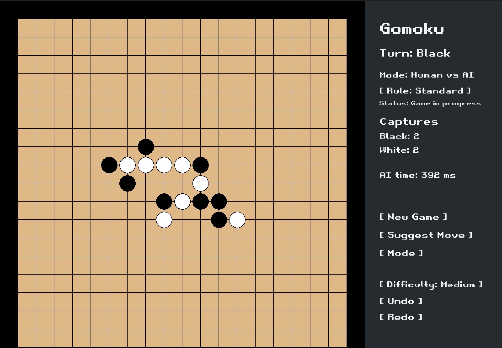
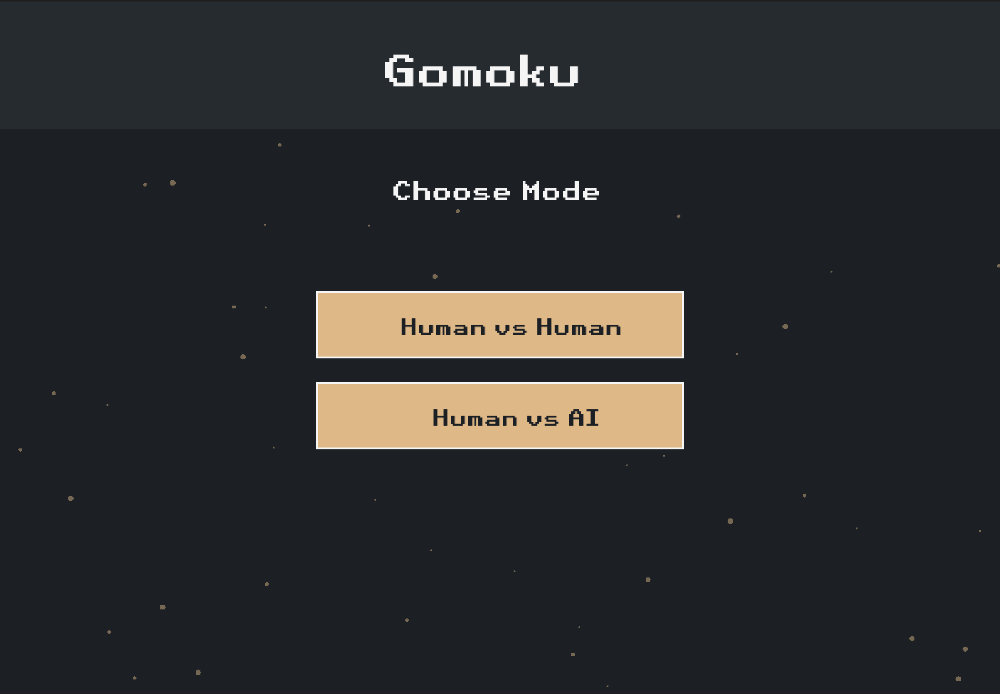
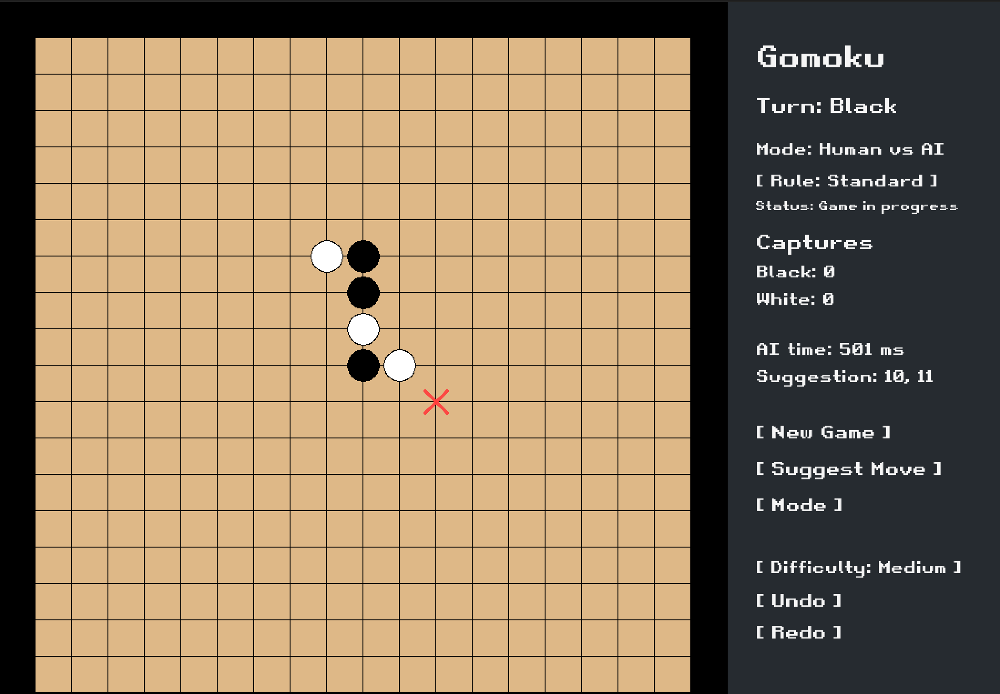
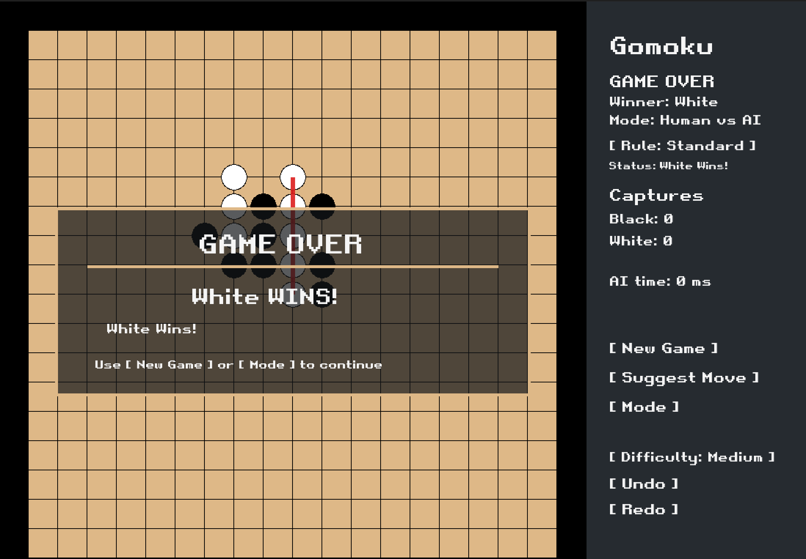

<div align="center">


### A strategy game. A custom engine. An AI built from scratch.

A C++ Gomoku implementation with an SFML interface, an optimized minimax opponent, capture mechanics, and multiple rule variants.

<p>
  
  
  
  
</p>

[Overview](#overview) · [Screenshots](#screenshots) · [Features](#features) · [AI Engine](#ai-engine) · [Getting Started](#getting-started) · [Tests](#tests)

</div>

<br />

## Overview

Gomoku is a turn-based strategy game where two players compete to form a line of five stones.

This project implements the board, rule checking, AI search, and graphical interface in C++. Alongside five-in-a-row gameplay, it includes pair captures, opening variants, move suggestions, and game history.

The main engineering challenge is searching a large move space while keeping the opponent responsive. The AI combines depth-limited search, pruning, position caching, and candidate move ordering to make decisions within a configurable time budget.

<br />

## Screenshots

### Gameplay

<!-- Add your main screenshot at screenshots/gameplay.png -->

<p align="center">
  
</p>

### Game modes

<!-- Add your mode selection screenshot at screenshots/modes.png -->

<p align="center">
  
</p>

<details>
<summary><strong>More screenshots</strong></summary>

<br />

### AI move suggestion

<!-- Add your suggestion screenshot at screenshots/ai-suggestion.png -->



### Game result

<!-- Add your result screenshot at screenshots/game-over.png -->



</details>

<br />

## Features

| Feature | Description |
| :--- | :--- |
| **19 × 19 board** | Interactive board with black and white stones |
| **Human vs. Human** | Local play between two players |
| **Human vs. AI** | Play against a custom search-based opponent |
| **Three difficulty levels** | Easy, Medium, and Hard with different search budgets |
| **Multiple rule variants** | Standard, Pro, Renju, Swap, and Swap2 |
| **Capture mechanics** | Capture opposing pairs and track capture totals |
| **Move suggestions** | Ask the AI to recommend a move for the current position |
| **Undo / Redo** | Navigate previous game states |
| **Rule feedback** | Feedback for invalid moves and opening decisions |
| **Game result display** | Winning player and end-of-game feedback |
| **New game controls** | Reset the board and start another match |

> Swap and Swap2 opening variants are available for local human play. The Human vs. AI interface excludes these opening variants.

<br />

## How to Play

1. Select a game mode.
2. Choose a rule variant.
3. For Human vs. AI, select the difficulty before placing the first stone.
4. Click an empty board intersection to place a stone.
5. Alternate turns and build threats while defending against your opponent.

### Winning

The implementation includes two routes to victory:

- **Five in a row:** form a horizontal, vertical, or diagonal line of five stones, subject to the selected rules and capture checks.
- **Captures:** capture five opposing pairs.

The game checks whether a formed five-stone line can still be broken by a capture before declaring a line victory.

### Controls

| Action | Control |
| :--- | :--- |
| Place a stone | Left-click an empty intersection |
| Start another match | **New Game** |
| Request a recommendation | **Suggest Move** |
| Return to mode selection | **Mode** |
| Change the rule variant | Click the rule selector |
| Change AI difficulty | Click the difficulty selector before the first move |
| Undo a move | **Undo** |
| Restore an undone move | **Redo** |

<br />

## Rule Variants

| Variant | Behavior |
| :--- | :--- |
| **Standard** | Basic opening without Pro or Renju restrictions |
| **Pro** | The first move is at the center; the third move must be outside the central 5 × 5 area |
| **Renju** | Black is restricted from double-three, double-four, and overline moves |
| **Swap** | An initial three-stone opening is followed by a color choice |
| **Swap2** | Extends Swap with the option to place two additional stones before the final color choice |

These variants operate within this project's capture-enabled implementation.

See [docs/rules.md](docs/rules.md) for the accompanying rule reference.

<br />

## AI Engine

The opponent uses classical game-tree search. It evaluates possible continuations rather than relying on a trained model or an external AI service.

### Search techniques

| Technique | Purpose |
| :--- | :--- |
| **Minimax** | Explore alternating moves for both players |
| **Alpha-beta pruning** | Skip branches that cannot improve the current decision |
| **Iterative deepening** | Search progressively deeper while retaining the last completed result |
| **Principal Variation Search** | Search promising moves first, then use narrower search windows for alternatives |
| **Transposition table** | Reuse cached evaluations of previously explored positions |
| **Move ordering** | Prioritize promising candidates to improve pruning |
| **Candidate filtering** | Focus on empty positions near existing stones |
| **Time budget** | Stop searching when the difficulty's allotted time is reached |

### Difficulty settings

| Difficulty | Maximum search depth | Search time budget |
| :--- | :---: | :---: |
| **Easy** | 5 | 150 ms |
| **Medium** | 10 | 500 ms |
| **Hard** | 11 | 1,500 ms |

These are configured limits, not guaranteed completed depths or measured response times. The search may finish early after finding a decisive result.

### Position evaluation

The evaluation function considers:

- Stone patterns across horizontal, vertical, and diagonal lines.
- Open ends and blocked lines.
- Offensive opportunities.
- Opponent threats.
- The difference in captured pairs.

Opponent threats receive extra defensive weight, helping the search balance attacking moves with immediate risks.

### Board representation

The board stores each intersection using two bits inside an array of 64-bit integers.

During search, separate color bitboards support pattern evaluation and rule checks. This keeps the board representation compact and enables bitwise operations on stone patterns.

<br />

## Architecture

The source is organized around separate responsibilities for game state, rules, search, and presentation.

| Component | Responsibility |
| :--- | :--- |
| **Board** | Stone storage, placement, removal, and board queries |
| **RuleChecker** | Capture logic, winning patterns, and variant restrictions |
| **MinimaxAI** | Candidate generation, position evaluation, and search |
| **Game** | Application entry into the game |
| **UIBoard** | SFML window, input, rendering, controls, and interactive game flow |

### Move flow

When a player places a stone, the interface:

1. Validates the position and applicable opening restrictions.
2. Saves a snapshot for game history.
3. Places the stone and applies captures.
4. Checks capture totals and line-based victory conditions.
5. Advances the turn or completes the game.
6. Requests an AI move when the next turn belongs to the computer.

### Source layout

| Path | Contents |
| :--- | :--- |
| `include/gomoku/` | Board, game, rules, AI, and supporting headers |
| `include/gomoku/ui/` | Graphical interface declarations |
| `src/ai/Minmax.cpp` | AI search and evaluation |
| `src/core/Board.cpp` | Board implementation |
| `src/core/Rules.cpp` | Rule checking and captures |
| `src/core/Game.cpp` | Game entry logic |
| `src/ui/UIBoard.cpp` | SFML interface and interactive flow |
| `src/app/main.cpp` | Application entry point |
| `src/infra/Logger.cpp` | Logging support |
| `src/assets/font/` | Interface font |
| `tests/TBoard.cpp` | Standalone rule and AI test harness |
| `docs/rules.md` | Rule reference |

<br />

## Getting Started

### Requirements

- A C++ compiler with C++17 support or newer.
- SFML 3.x for the graphical interface.
- Git.

The interface uses SFML 3 APIs, including the optional event polling API.

### Clone

```bash
git clone https://github.com/ayoub-essarghini/gomoku.git
cd gomoku
```

### Build status

The current repository does not include a Makefile or CMake configuration.

To build from source, configure your compiler or IDE to:

- Include the `include/` directory.
- Compile the application sources under `src/`.
- Link SFML Graphics, Window, and System.
- Enable C++17 or newer.

Build commands will depend on your SFML installation and platform.

### Run

After building an executable named `gomoku`, launch it from the repository root:

```bash
./gomoku
```

Running from the repository root allows the interface to find:

```text
src/assets/font/retro_gaming.ttf
```

The repository also contains a `gomoku` binary. Its compatibility depends on the platform and libraries used to build it; rebuilding from source is recommended.

<br />

## Tests

The project includes a standalone test harness in [`tests/TBoard.cpp`](tests/TBoard.cpp).

It reports individual checks as **PASS** or **FAIL** and returns a nonzero exit code when a check fails.

### Rule checks

- Classic double-three detection.
- Single-three acceptance.
- Broken-three patterns.
- Blocked-three handling.
- Double-four detection.
- Overline detection.
- Exact five-in-a-row acceptance.

### AI checks

- Choosing the center on an empty board.
- Taking an immediate winning move.
- Blocking an immediate opponent threat.
- Choosing a capture victory.
- Preserving the real board during search.
- Respecting the Pro opening restriction.
- Avoiding a Renju double-three foul.

A dedicated test build should compile `tests/TBoard.cpp` with the board, rules, and AI implementations, excluding the application's `main.cpp`.

<br />

## Engineering Focus

This project explores several problems that extend beyond board games:

- Searching a large decision space under a time constraint.
- Using cached results to avoid repeated computation.
- Representing state compactly with bit operations.
- Implementing rules with interacting edge cases.
- Restoring previous states through snapshots.
- Connecting a computation-heavy engine to an interactive interface.

<br />

## Current Limitations

- Build configuration is not yet included in the repository.
- AI calculation runs synchronously in the UI loop, so input handling can pause while the opponent searches.
- Swap and Swap2 openings are excluded from Human vs. AI mode.
- The test harness targets specific rule and AI scenarios; it is not a complete UI or gameplay test suite.

<br />

## Possible Next Steps

- Add a reproducible CMake build for the application and tests.
- Move AI search to a worker thread.
- Expand tests for captures, opening transitions, and history restoration.
- Add saved games and replay support.
- Add AI benchmarks using fixed board positions.
- Package releases for supported platforms.

<br />

---

<div align="center">

**Built by [Ayoub Es Sarghini](https://github.com/ayoub-essarghini) & [Hassan Lakhal](https://github.com/hassanlakhal)**

[Portfolio](https://www.ayoub-essarghini.com/) · [LinkedIn](https://www.linkedin.com/in/ayoub-es-sarghini-839973212)


</div>
